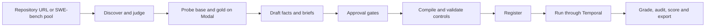

# swesim

swesim turns underspecified GitHub issues into interactive software-engineering tasks. A coding agent can ask a simulated stakeholder about missing requirements, implement a patch, and receive a grade from hidden tests in a separate offline container. Asking changes the information available to the agent; it does not change the reward contract.

Task creation and graded trials run through Temporal. The hosted implementation uses **Temporal Cloud, four Cloud Run worker pools, one Cloud Run Job per trial, a versioned GCS record, a rebuildable Cloud SQL index, and an IAP-protected console**. Harbor 0.23.0 builds and runs the agent and verifier environments on Modal; the stakeholder also runs on Modal. A laptop is an operator client.

## Start here

A stranger needs: a billing-enabled GCP project, a Temporal Cloud namespace with an API key, Modal, Anthropic/OpenAI/OpenRouter and GitHub credentials, and `git`, `uv`, Terraform, `gcloud`, `gh` on the laptop. Follow [cloud setup](docs/setup.md) step by step (seven steps, each with its check), then [the runbook](docs/runbook.md) for operations. Configuration lives in a git-ignored `./.env` (or the file named by `SWESIM_ENV_FILE`) generated from `.env.example`, which explains every variable. Local Docker is not required.

```bash
uv sync --extra dev --frozen
uv run --frozen --offline python -m pytest -q tests --ignore=tests/integration
uv run --frozen swesim --help
```

The first two lines are `make check`; the integration tests under `tests/integration` need credentials and are not part of the offline suite.

After the setup prerequisites:

```bash
make cloud-bootstrap PROJECT=YOUR_PROJECT REGION=us-central1 SWESIM_ENV_FILE=./.env
```

The console URL is the Terraform `console_url` output. Sign in with an IAP-allowed Google account. Browse **Scenarios**, **Trials**, **Workflows**, **Candidates**, **Database** and the artifact views. Mutations require confirmation; evaluator-only artifacts require a verified IAP identity on the evaluator list.

Workflow inspection is also available from the CLI:

```bash
uv run --frozen swesim workflows list all
uv run --frozen swesim workflows progress WORKFLOW_ID
```

Replace uppercase placeholders. Task creation and graded runs start from the console's Create/Run pages or `swesim create` and `swesim run-tasks`; both go through Temporal. The stage commands are internal building blocks; their direct execution switch is for debugging one stage, not operating the pipeline.

## How a task is created



The natural issue remains the original text. Withholding removes selected spans and records each occurrence in a ledger. Every stakeholder requirement must be grounded in a visible fact or a verbatim human statement. Author-only facts stay outside the stakeholder view. The judge and drafter resolve to different model ids.

| Condition | Information available |
|---|---|
| Full | Natural brief plus stakeholder-visible facts |
| Hidden | Selected natural or withheld brief |
| Interactive | The same selected brief plus `ask-user` and `confirm-behavior` |

Repository discovery has explicit `bugfix` and `feature` bands. Diff size is a candidate filter, not measured difficulty. Discovery rejection counts and subsequent candidate gate rejections have distinct labels in the console; historical discovery snapshots retain their provenance.

Eight automatic approval gates cover schema, asset hashes, judge acceptance, an on-request fact linked to FAIL_TO_PASS, grounded requirements, withholding leaks, exact brief reconstruction, and controls. Validation then executes the no-op, oracle, plausible-wrong and tamper controls and checks gold reachability. Infrastructure failure does not count as a defeated attack.

## Hosted state — 2026-09-13

Console: <https://<console-host>> (native IAP; an unauthenticated request is redirected to Google sign-in, `workspace/evidence/cloud/iap-headers-20260913T183003Z.txt`). Project `YOUR_PROJECT`, region `us-central1`, Temporal Cloud namespace `swesim.abcde`.

| Fact | Value | Source |
|---|---|---|
| Newest verified deploy | commit `609f923` (`609f923557ca0807e1e90cde0114057f77fce027`), image `worker@sha256:f2b265054b9ea61d442957945d94ad89ee544e4683475ee41a85889bb8f425fc`, Terraform 0 added / 6 changed / 0 destroyed, migration execution `swesim-index-maintenance-nzrvm` completed, `verify_cloud` `result: OK` (API-key Temporal, pollers on all four queues, IAP 302, four pools and console Ready on the pinned image) | `workspace/evidence/cloud/deploy-609f923.log`, `verify_cloud-20260913T183003Z.txt` |
| Newest deploy | commit `1ca70a6` (`1ca70a66d142210bb25b4a6edf3744e204bcad30`), image `worker@sha256:e21881d64fbed1597cfd637f3f595c0082d193b7d2718d321cd45ae98dc8e271`, applied (0 / 6 / 0) with the recorded open-executions override; its migration and verification had not finished when this was written (18:49 UTC) | `deploy-1ca70a6.log`, `open-types-20260913T184221Z.txt`, `terraform-apply-20260913T184612Z.txt` |
| Hosted creation workflows | `create-fa2489a292574fd19ba88796c0c18087` (`swebench:A:pytest-dev__pytest-7283`) and `create-3b1513db47894549a189f678343774b9` (`encode/httpx`, bugfix), started 18:31 UTC — the first workflows in the namespace; both blocked on a worker image without `gh` (fixed in `Dockerfile.worker`, commit `1555810`, carried by `1ca70a6`); resubmission pending | `workspace/evidence/smoke/`, [ops.md](docs/ops.md#hosted-smoke-2026-09-13) |
| Hosted graded trials | none yet (`NOTE no swesim-trial-* Jobs yet`) | `verify_cloud-20260913T183003Z.txt` |
| Preserved laptop/VM record | 50 trial records, 19 matching the three registered version-2 specs (`mwaskom--seaborn-3190`, `scikit-learn--scikit-learn-13584`, `py-pdf--pypdf-3826`), 13 correct / 6 incorrect; not a hosted comparison | [grading.md](docs/grading.md#preserved-inventory--2026-09-13) |
| Model roles in force | judge `openai/gpt-5.5`, drafter/stakeholder/audit `openai/gpt-5.6-sol`, screen `openrouter/deepseek/deepseek-v3.2` — fallbacks after the Anthropic workspace limit; the configured judge stays `anthropic/claude-opus-5` by directive | `workspace/evidence/model-probe-takeover.json`, [ops.md](docs/ops.md#model-role-fallbacks-in-force) |

Everything a finishing stream cut on 2026-09-13 is listed with its destination in [ops.md](docs/ops.md#deferred-from-the-2026-09-13-finishing-run). See [grading](docs/grading.md) for the grading contract, the historical results and their limits.

## Trust and measurement

The compiler hashes its render configuration and file manifest. Runs verify that manifest before use. The root collector records its base-manifest digest; the separate verifier requires the same base before grading. Reward is partial credit by fixed requirement groups, with any regression forcing zero; success means the full contract passed.

The stakeholder exposes reply text and remaining patience. Patience tier, fact labels, redactions and usage stay evaluator-only. Code filters cover hidden-test identifiers and recognized option markers; semantic reporter behavior remains partly prompt-enforced and is measured by the disclosure audit.

Submitted code still executes inside pytest and can attempt coordinated report forgery. These checks are tested defenses, not a proof of complete isolation from in-process attacks. Interactive exports remain unadjudicated until reviewed. Historical non-interactive `training_eligible` flags are exporter metadata, not a substitute for task-sense review.

## Repository map

- [Setup](docs/setup.md), [runbook](docs/runbook.md), [architecture](docs/architecture.md), [grading](docs/grading.md), [operations evidence](docs/ops.md).
- `swesim/`: models, stages, sources, verifier, stakeholder, Temporal workflows, index and console.
- `infra/`, `Dockerfile.worker`, `cloudbuild.yaml`, `scripts/cloud/`: hosted infrastructure and deployment.
- `workspace/`: ignored local mirror; the hosted bucket is the authoritative record.
- `examples/mwaskom--seaborn-3190/`: historical sanitized example, with a manifest.
- [Hosted design](docs/superpowers/specs/2026-09-13-gcp-hosting-design.md): implemented topology and acceptance status.
