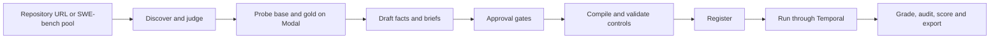

# swesim

swesim turns underspecified GitHub issues into interactive software-engineering tasks. A coding agent can ask a simulated stakeholder about missing requirements, implement a patch, and receive a grade from hidden tests in a separate offline container. Asking changes the information available to the agent; it does not change the reward contract.

Task creation and graded trials run through Temporal. The hosted implementation uses **Temporal Cloud, four Cloud Run worker pools, one Cloud Run Job per trial, a versioned GCS record, a rebuildable Cloud SQL index, and an IAP-protected console**. Harbor 0.23.0 builds and runs the agent and verifier environments on Modal; the stakeholder also runs on Modal. A laptop is an operator client.

## Start here

Follow [cloud setup](docs/setup.md) for credentials and a new deployment, then [the runbook](docs/runbook.md) for operations. The setup uses a git-ignored `.env`, Python 3.12 through `uv`, Terraform, `gcloud`, GitHub and Modal credentials, and a Temporal Cloud namespace. Local Docker is not required.

```bash
make check
uv run --frozen swesim --help
```

After the setup prerequisites:

```bash
make cloud-bootstrap PROJECT=YOUR_PROJECT REGION=us-central1 SWESIM_ENV_FILE=./.env
```

The console URL is the Terraform `console_url` output. Sign in with an IAP-allowed Google account. Browse **Scenarios**, **Trials**, **Workflows**, **Candidates**, **Database** and the artifact views over the preserved record. Mutations require confirmation; evaluator-only artifacts require a verified IAP identity on the evaluator list. The current priority is the working hosted website; new discovery and experiments are deferred.

Workflow inspection is also available from the CLI:

```bash
uv run --frozen swesim workflows list all
uv run --frozen swesim workflows progress WORKFLOW_ID
```

Replace uppercase placeholders. When experiments resume, use the console's Create/Run pages or `swesim create` and `swesim run-tasks`, after current validation. The stage commands are internal building blocks; their direct execution switch is for debugging one stage, not operating the pipeline.

## How a task is created



The natural issue remains the original text. Withholding removes selected spans and records each occurrence in a ledger. Every stakeholder requirement must be grounded in a visible fact or a verbatim human statement. Author-only facts stay outside the stakeholder view. The judge and drafter resolve to different model ids.

| Condition | Information available |
|---|---|
| Full | Natural brief plus stakeholder-visible facts |
| Hidden | Selected natural or withheld brief |
| Interactive | The same selected brief plus `ask-user` and `confirm-behavior` |

Repository discovery has explicit `bugfix` and `feature` bands. Diff size is a candidate filter, not measured difficulty. Discovery rejection counts and subsequent candidate gate rejections have distinct labels in the console; historical discovery snapshots retain their provenance.

Eight automatic approval gates cover schema, asset hashes, judge acceptance, an on-request fact linked to FAIL_TO_PASS, grounded requirements, withholding leaks, exact brief reconstruction, and controls. Validation then executes the no-op, oracle, plausible-wrong and tamper controls and checks gold reachability. Infrastructure failure does not count as a defeated attack.

## Measured status — 2026-09-13

The hosted infrastructure has passed an authenticated Temporal Cloud and runtime-poller check. Evidence `workspace/evidence/cloud/verify_cloud-20260913T164426Z.txt` records API-key authentication, activity pollers on all four queues, workflow pollers, IAP HTTP 302, Ready resources, and image parity. The index maintenance Job also completed its migration.

**Website acceptance requires imported-record/index parity, authenticated page checks and the final deployed image/schema.** New hosted creation, graded trials, worker-restart experiments and the model sweep are deferred. The verification file explicitly reports no trial Jobs and skips remote SQL status; it does not establish complete bucket/index parity. The earlier 09:17 UTC verification used localhost Temporal and missed a trials-worker crash loop; it is not hosted workflow evidence.

The preserved laptop/VM record contains:

| Inventory | Count |
|---|---:|
| Historical trial records | 50 |
| Records matching the three current version-2 specs | 19 |
| Registered version-2 scenarios | 3 |
| New hosted graded outcomes established by the evidence above | 0 |

The 19 current-spec records comprise 13 correct and 6 incorrect historical outcomes across different models and conditions. They are not a new hosted comparison. The registered scenarios are `mwaskom--seaborn-3190`, `scikit-learn--scikit-learn-13584`, and `py-pdf--pypdf-3826`; their older approval and validation records predate the new build-manifest and base-parity checks. New execution requires current compilation and validation.

The takeover model probe found the configured Anthropic primaries quota-limited. Its recorded resolution is judge `openai/gpt-5.5`, drafter/stakeholder/audit `openai/gpt-5.6-sol`, and screen `openrouter/deepseek/deepseek-v3.2`. These are observed fallbacks, not graded results; later workflows record their own resolved ids.

See [operations evidence](docs/ops.md) for commands, dates and pending checks, and [grading](docs/grading.md) for historical results and their limits.

## Trust and measurement

The compiler hashes its render configuration and file manifest. Runs verify that manifest before use. The root collector records its base-manifest digest; the separate verifier requires the same base before grading. Reward is partial credit by fixed requirement groups, with any regression forcing zero; success means the full contract passed.

The stakeholder exposes reply text and remaining patience. Patience tier, fact labels, redactions and usage stay evaluator-only. Code filters cover hidden-test identifiers and recognized option markers; semantic reporter behavior remains partly prompt-enforced and is measured by the disclosure audit.

Submitted code still executes inside pytest and can attempt coordinated report forgery. These checks are tested defenses, not a proof of complete isolation from in-process attacks. Interactive exports remain unadjudicated until reviewed. Historical non-interactive `training_eligible` flags are exporter metadata, not a substitute for task-sense review.

## Repository map

- [Setup](docs/setup.md), [runbook](docs/runbook.md), [architecture](docs/architecture.md), [grading](docs/grading.md), [operations evidence](docs/ops.md).
- `swesim/`: models, stages, sources, verifier, stakeholder, Temporal workflows, index and console.
- `infra/`, `Dockerfile.worker`, `cloudbuild.yaml`, `scripts/cloud/`: hosted infrastructure and deployment.
- `workspace/`: ignored local mirror; the hosted bucket is the authoritative record.
- `examples/mwaskom--seaborn-3190/`: historical sanitized example, with a manifest.
- [Hosted design](docs/superpowers/specs/2026-09-13-gcp-hosting-design.md): implemented topology and acceptance status.
