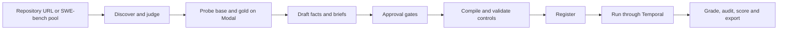

# swesim

swesim turns underspecified GitHub issues into interactive software-engineering tasks. A coding agent can ask a simulated stakeholder about missing requirements, implement a patch, and receive a grade from hidden tests in a separate offline container. Asking changes the information available to the agent; it does not change the reward contract.

Task creation and graded trials run through Temporal. The hosted implementation uses **Temporal Cloud, four Cloud Run worker pools, one Cloud Run Job per trial, a versioned GCS record, a rebuildable Cloud SQL index, and an IAP-protected console**. Harbor 0.23.0 builds and runs the agent and verifier environments on Modal; the stakeholder also runs on Modal. A laptop is an operator client.

## Start here

A stranger needs: a billing-enabled GCP project, a Temporal Cloud namespace with an API key, Modal, Anthropic/OpenAI/OpenRouter and GitHub credentials, and `git`, `uv`, Terraform, `gcloud`, `gh` on the laptop. Follow [cloud setup](docs/setup.md) step by step (seven steps, each with its check), then [the runbook](docs/runbook.md) for operations. Configuration lives in a git-ignored `./.env` (or the file named by `SWESIM_ENV_FILE`) generated from `.env.example`, which explains every variable. Local Docker is not required.

```bash
uv sync --extra dev --frozen
uv run --frozen --offline python -m pytest -q tests --ignore=tests/integration
uv run --frozen swesim --help
```

The first two lines are `make check`; the integration tests under `tests/integration` need credentials and are not part of the offline suite.

After the setup prerequisites:

```bash
make cloud-bootstrap PROJECT=YOUR_PROJECT REGION=us-central1 SWESIM_ENV_FILE=./.env
```

The console URL is the Terraform `console_url` output. Sign in with an IAP-allowed Google account. Browse **Scenarios**, **Trials**, **Workflows**, **Candidates**, **Database** and the artifact views. Mutations require confirmation; evaluator-only artifacts require a verified IAP identity on the evaluator list.

Workflow inspection is also available from the CLI:

```bash
uv run --frozen swesim workflows list all
uv run --frozen swesim workflows progress WORKFLOW_ID
```

Replace uppercase placeholders. Task creation and graded runs start from the console's Create/Run pages or `swesim create` and `swesim run-tasks`; both go through Temporal. The stage commands are internal building blocks; their direct execution switch is for debugging one stage, not operating the pipeline.

## How a task is created



The natural issue remains the original text. Withholding removes selected spans and records each occurrence in a ledger. Every stakeholder requirement must be grounded in a visible fact or a verbatim human statement. Author-only facts stay outside the stakeholder view. The judge and drafter resolve to different model ids.

| Condition | Information available |
|---|---|
| Full | Natural brief plus stakeholder-visible facts |
| Hidden | Selected natural or withheld brief |
| Interactive | The same selected brief plus `ask-user` and `confirm-behavior` |

Repository discovery has explicit `bugfix` and `feature` bands. Diff size is a candidate filter, not measured difficulty. Discovery rejection counts and subsequent candidate gate rejections have distinct labels in the console; historical discovery snapshots retain their provenance.

Eight automatic approval gates cover schema, asset hashes, judge acceptance, an on-request fact linked to FAIL_TO_PASS, grounded requirements, withholding leaks, exact brief reconstruction, and controls. Validation then executes the no-op, oracle, plausible-wrong and tamper controls and checks gold reachability. Infrastructure failure does not count as a defeated attack.

## Hosted state — 2026-09-13

Console: <https://<console-host>> (native IAP; an unauthenticated request is redirected to Google sign-in, `workspace/evidence/cloud/iap-headers-20260913T202624Z.txt`). Region `us-central1`, Temporal Cloud namespace `swesim.abcde`; the GCP project id is in the header line of every `workspace/evidence/cloud/verify_cloud-*.txt`.

| Fact | Value | Source |
|---|---|---|
| Deployed commit and image | `cf471f6` (`cf471f618aad66090225f78089b3e3da4e4c0f27`), image `worker@sha256:2c539bf4b58b3a7aa0fbc017dfbf08c6dbc40da1ebc5ab0c3143407d473fb79e`; Cloud Build `d8467c3e…` SUCCESS; Terraform 0 added / 6 changed / 0 destroyed; migration execution `swesim-index-maintenance-hmmls` completed, Alembic head `0005_funnel_versions`; `verify_cloud` `result: OK` at 20:26:24 UTC (API-key Temporal with pollers on all four queues, IAP 302, four pools and console Ready on the pinned image, 16 `swesim-trial-*` Jobs each with exactly one execution). The seventh verified deploy of the afternoon; the six before it, with digests, are in ops.md. | `workspace/evidence/cloud/deploy-cf471f6.log`, `verify_cloud-20260913T202624Z.txt`, [ops.md](docs/ops.md#hosted-runs-2026-09-13-afternoon) |
| Hosted task creation | `pytest-dev--pytest-7283` (SWE-bench pool A) registered through seven executed controls by `create-b788cb22d7064a4d8bcbe63bb943c709` — the first hosted valid task. Repository creations have yielded no novel task yet: `encode/httpx` 0 PRs merged since 2026-06-01; `pydantic/pydantic` and `pytest-dev/pytest` 3 candidates each, all rejected (judge; not reproducible offline; alternative-correct control failed); a nine-repository sweep hit GitHub's secondary rate limit (six of nine errored; handling fixed and deployed in `cf471f6`). **The since-2023 both-band sweep is running** (10 repositories × bugfix/feature, one scan at a time; first creation `create-06b18aec377b4697986b09e6d8dcc84d`, log written 20:26 UTC). | `workspace/evidence/smoke/`, [ops.md](docs/ops.md#creation-workflows) |
| Hosted graded trials | **29 trials, $3.01 in total** (`total_trials: 29`, `total_cost_usd: 3.0124`), all on `pytest-dev--pytest-7283`: the first, `50d797789546d178d8add487`, ran as one Cloud Run Job with one execution while a deploy rolled the trials pool (valid-incorrect, reward 0.0); a screen (`broken` for the screen model `openrouter/deepseek/deepseek-v3.2`); and a four-model × three-condition × k=2 comparison (24 trials). Per-cell numbers, the inverted full/hidden ordering it exposed and what the data does not show are in grading.md. | `workspace/evidence/sweep/pytest-7283-comparison-2026-09-13.json`, `workspace/evidence/cloudrun/executions-50d797789546d178d8add487.json`, [grading.md](docs/grading.md#first-hosted-results-2026-09-13) |
| Preserved laptop/VM record | 50 trial records, 19 matching the three registered version-2 specs (`mwaskom--seaborn-3190`, `scikit-learn--scikit-learn-13584`, `py-pdf--pypdf-3826`), 13 correct / 6 incorrect; not a hosted comparison | [grading.md](docs/grading.md#preserved-inventory--2026-09-13) |
| Model roles | Workflows started before the `400c288` roll (verified 19:12 UTC), including the one that registered pytest-7283: judge `openai/gpt-5.5`, drafter/stakeholder/audit `openai/gpt-5.6-sol` — fallbacks after the Anthropic workspace limit. After the roll, with key version 2 in Secret Manager, roles resolve to the configured heads (`anthropic/claude-opus-5` judge/stakeholder, `anthropic/claude-sonnet-5` drafter); the comparison run's stakeholder was Opus 5. Screen `openrouter/deepseek/deepseek-v3.2` throughout. Every record names the id that actually ran. | `workspace/evidence/model-probe-takeover.json`, [ops.md](docs/ops.md#model-role-fallbacks-in-force) |

Everything a finishing stream cut on 2026-09-13, plus what the afternoon runs added to that list, is in [ops.md](docs/ops.md#deferred-from-the-2026-09-13-finishing-run). See [grading](docs/grading.md) for the grading contract, the hosted results and the historical record with their limits.

## Trust and measurement

The compiler hashes its render configuration and file manifest. Runs verify that manifest before use. The root collector records its base-manifest digest; the separate verifier requires the same base before grading. Reward is partial credit by fixed requirement groups, with any regression forcing zero; success means the full contract passed.

The stakeholder exposes reply text and remaining patience. Patience tier, fact labels, redactions and usage stay evaluator-only. Code filters cover hidden-test identifiers and recognized option markers; semantic reporter behavior remains partly prompt-enforced and is measured by the disclosure audit.

Submitted code still executes inside pytest and can attempt coordinated report forgery. These checks are tested defenses, not a proof of complete isolation from in-process attacks. Interactive exports remain unadjudicated until reviewed. Historical non-interactive `training_eligible` flags are exporter metadata, not a substitute for task-sense review.

## Repository map

- [Setup](docs/setup.md), [runbook](docs/runbook.md), [architecture](docs/architecture.md), [grading](docs/grading.md), [operations evidence](docs/ops.md).
- `swesim/`: models, stages, sources, verifier, stakeholder, Temporal workflows, index and console.
- `infra/`, `Dockerfile.worker`, `cloudbuild.yaml`, `scripts/cloud/`: hosted infrastructure and deployment.
- `workspace/`: ignored local mirror; the hosted bucket is the authoritative record.
- `examples/mwaskom--seaborn-3190/`: historical sanitized example, with a manifest.
- [Hosted design](docs/superpowers/specs/2026-09-13-gcp-hosting-design.md): implemented topology and acceptance status.
