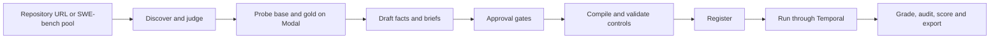

# swe-sim

swe-sim turns underspecified GitHub issues into graded tasks for coding agents. The agent gets the issue as its
reporter wrote it and a simulated stakeholder it may ask about what is missing. It submits a patch, and hidden tests
in a separate offline container grade it. Each task runs in three conditions against one frozen reward contract, so
you can measure what asking is worth. A task enters the pool only after a set of executed controls shows its grader
cannot be fooled by a no-op, a wrong patch or a tampered test run.

The Python package and the CLI are both named `swesim`.

## The idea

Many SWE-bench issues are underspecified: the information that settled them is in the discussion thread and the
fix, not in the issue. swe-sim keeps the issue as the brief. It moves the missing information into a ledger of
facts, each quoted from the thread or the fix, and gives the stakeholder those facts. The stakeholder speaks as the
reporter. It describes the behaviour wanted and observed, and never the tests, the oracle or which of the agent's
options to pick.

| Condition | What the agent sees |
|---|---|
| `full` | The natural brief plus every stakeholder-visible fact |
| `hidden` | The selected brief only: the natural issue, or a withheld version with recorded spans removed |
| `interactive` | The same brief as `hidden`, plus `ask-user` and `confirm-behavior` to reach the stakeholder |

All three conditions share one contract. The FAIL_TO_PASS tests are split into weighted requirement groups. The
reward is partial credit over those groups, and any PASS_TO_PASS regression sets it to zero. `success` means the whole
contract passed. Asking changes what the agent knows, never the tests or the weights.

Grading happens in a separate offline container. A root-owned collector freezes the submitted tree and the
stakeholder transcript. The verifier diffs the tree against the untouched base and drops edits to protected paths
(contract tests, pytest configuration, conftest and startup hooks, package metadata). It then runs the hidden tests
and requires the collected test ids, JUnit, the terminal summary and the exit status to agree. The full contract is
in [docs/grading.md](docs/grading.md).

A drafted task must pass nine code-owned approval gates: schema, asset hashes, judge acceptance, a load-bearing
on-request fact, grounded requirements, withholding leaks, exact brief reconstruction, controls present, and fact
scope. It then must pass executed controls before it can be registered:

| Control | Must show |
|---|---|
| No-op | Reward 0; the FAIL_TO_PASS tests fail on the base and the PASS_TO_PASS tests hold |
| Oracle (the real fix) | Success 1 and reward 1 |
| Plausible-wrong patch | Applies, fails correctness, stays under its declared reward ceiling |
| Tamper (root `conftest.py`, `sitecustomize.py`, skip marker) | Applies and earns exactly 0 without an infrastructure failure |
| Reachability probe | The gold commit and distinctive post-fix lines cannot be reached from the agent's environment |

## How a task is made and run



Tasks come from two sources: the human-annotated SWE-bench Verified pool, and any GitHub repository URL, where
discovery finds merged PRs with linked issues and filters them by diff size. Tasks are compiled to
[Harbor](https://github.com/laude-institute/harbor) 0.23 task directories, and Harbor builds and runs both images on
Modal. The agent is mini-swe-agent, running as an unprivileged user with a host allowlist; the verifier has no
network. Temporal orchestrates creation and trials. The hosted deployment consists of four Cloud Run worker pools,
one Cloud Run Job per trial, a versioned GCS bucket as the record, a Cloud SQL index and an IAP-protected console
([docs/architecture.md](docs/architecture.md)).

## Run it locally

You need Python 3.12 and [uv](https://docs.astral.sh/uv/). The offline suite needs no credentials, no Docker and no
network after the first sync:

```bash
uv sync --extra dev --frozen
uv run --frozen --offline python -m pytest -q tests --ignore=tests/integration
uv run --frozen swesim --help
```

`tests/test_compile.py::test_llm_helpers` expects `OPENAI_API_KEY` to be absent. If your shell exports it, run the
suite under `env -u OPENAI_API_KEY`. The tests under `tests/integration` need live credentials.

You can inspect the tracked example offline as well. These commands check every file against the example's manifest
and recompute one run's reward from the verifier's per-test observations
([examples/README.md](examples/README.md#reproducing-the-grading-offline) walks through each file):

```bash
uv run --frozen python -c "
import hashlib, json, pathlib
root = pathlib.Path('examples/mwaskom--seaborn-3190'); m = json.load(open(root / 'manifest.json'))
bad = [p for p, h in m['files'].items() if hashlib.sha256((root / p).read_bytes()).hexdigest() != h]
print('ok' if not bad else bad)"
```

To create and run tasks yourself you need a Modal account, model-provider keys (Anthropic, OpenAI or OpenRouter, per
the roles you configure), a GitHub token for mining and a Temporal namespace. Configuration lives in a git-ignored
`.env` generated from [.env.example](.env.example), which explains every variable. The supported deployment is the
hosted one: [docs/setup.md](docs/setup.md) goes from an empty GCP project to a running pipeline in seven checked
steps, and [docs/runbook.md](docs/runbook.md) covers operations. `scripts/vm/` keeps an older single-VM backend with
a local Temporal dev server.

## Results

Every number below comes from a file in this repository. The sample sizes are small, so treat them as measurements
of the pipeline, not as claims about models.

**The tracked example passes its controls.** `examples/mwaskom--seaborn-3190/validation.json` records the controls
that admitted SWE-bench instance `mwaskom__seaborn-3190`. The no-op scored reward 0 (FAIL_TO_PASS 0 of 1,
PASS_TO_PASS 84 of 84). The oracle scored reward 1. The plausible-wrong patch scored 0. Each of the three tamper
patches scored 0 with a `protected-path-edit` signal. The reachability probe found no gold-commit hits. The three
tracked runs, two `interactive` and one `hidden`, each scored reward 1.0 with 85 of 85 tests passing
(`runs/*/reward.json`). In one interactive run the agent asked one question, got a behaviour-level answer and had its
fix confirmed. The hidden run passed too, so on this task the model did not need the stakeholder.

**The first hosted task found a task-authoring defect.** On `pytest-dev--pytest-7283`, 29 hosted trials cost $3.01
in total: four models, three conditions, k=2, plus a screen and a demonstration run. Two models solved every
condition (7 of 7 and 6 of 6). For the other two, scores ran the wrong way: `full` < `hidden` < `interactive`
(0/3, 3/5, 2/2 and 0/2, 1/2, 2/2). The cause was a stakeholder-visible fact that described behaviour only a
PASS_TO_PASS test covered. Agents given every fact acted on it, and one regressed a passing test. The fix was a
ninth approval gate, `fact-scope`, which rejects such a fact. The per-cell table, costs and caveats are in
[docs/grading.md](docs/grading.md#first-hosted-results-2026-09-13).

**The issue judge is weak on recall.** The judge decides which issues count as underspecified. Against the human
labels on 145 annotated SWE-bench rows, `openai/gpt-5.5` scored agreement 0.655, precision 0.644 and recall 0.460, and
`anthropic/claude-opus-5` scored 0.634, 0.604 and 0.460. Answering "not underspecified" every time would score
82/145 = 0.566 on the same rows (from the confusion counts in
[docs/grading.md](docs/grading.md#judge-calibration)). The judge misses more than half of the underspecified issues.

**Earlier runs, kept separate.** `registry.json` lists three version-2 scenarios. Their 19 current-spec trials
scored 6/6 on seaborn, 7/7 on scikit-learn and 0/6 on pypdf. The saved task-sense audit flags the pypdf hidden test
as unfair: it calls a helper that only the oracle introduces. So that 0/6 shows a task defect, not difficulty
([docs/grading.md](docs/grading.md#preserved-inventory--2026-09-13)).

**Limits.** Submitted code runs inside pytest's process and can try to forge its reports. The four-way evidence
check catches disagreement, but it does not prove isolation. The stakeholder's reporter stance is partly
prompt-enforced and is measured by a disclosure audit. Interactive episodes stay unadjudicated until a person
reviews them.

## Repository map

- `swesim/`: models, stages (mine, judge, draft, approve, compile, validate, run, score, export), sources,
  verifier, stakeholder service, Temporal workflows, index and console.
- `tests/`: the offline suite; `tests/integration/` needs credentials.
- `examples/mwaskom--seaborn-3190/`: a sanitized, hash-listed snapshot of one validated task and three runs.
- `infra/`, `Dockerfile.worker`, `cloudbuild.yaml`, `scripts/cloud/`: hosted infrastructure and deployment.
- `docs/`: [architecture](docs/architecture.md), [grading](docs/grading.md), [setup](docs/setup.md),
  [runbook](docs/runbook.md), [operations record](docs/ops.md); `docs/superpowers/` holds the design specs and
  plans, and `docs/reviews/` holds adversarial reviews of the design.
- `data/annotations/`: OpenAI's SWE-bench Verified annotations, which the SWE-bench source and the judge
  calibration read, plus two pool subsets derived from them.

## Licence

MIT, © 2026 Saahil Sanganeriya; see [LICENSE](LICENSE). Third-party material keeps its own terms: OpenAI's
annotation file in `data/annotations/` and Harbor's SWE-bench adapter template in
`references/harbor-swebench-adapter-template/`.
