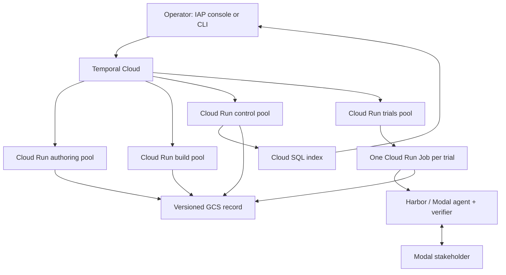

# Architecture

swesim creates tasks whose missing requirements can be clarified through a simulated stakeholder, then grades submitted source against a fixed hidden contract. This document describes the implemented components. [Operations evidence](ops.md) records which paths have actually run; readiness and offline tests are distinct from hosted trial acceptance.

## Hosted components

| Component | Responsibility |
|---|---|
| Temporal Cloud | Durable workflow history, retries, signals and cancellation |
| `swesim-authoring` | LLM and discovery activities; workflow-task polling |
| `swesim-build` | Probe, compilation and control-validation activities |
| `swesim-trials` | Launch, poll, cancel and clean up trial runtimes |
| `swesim-control` | Indexing, cost/spend hooks and audits |
| Cloud Run trial Job | Runs the frozen trial request and Harbor client independently of worker-pool lifetime |
| Modal | Builds task images, runs the agent sandbox and separate verifier; hosts stakeholder sessions |
| Versioned GCS bucket | Authoritative artifacts, mounted at `/workspace` |
| Cloud SQL PostgreSQL 16 | Rebuildable index and cross-process advisory locks |
| Cloud Run console | IAP-authenticated operations, history, measurement and artifact views |
| Index-maintenance Job | Migrations and record rebuilds with the hosted SQL connection |

All hosted workloads use a digest-pinned image built by Cloud Build. Terraform supplies the image reference, digest, runtime service account, SQL connection, queue and workspace settings. Secret Manager supplies secret values at runtime. The console has a read-only record mount; workers and Jobs write the record.

The VM/systemd launcher remains for preserved demonstrations and fallback operation. It is a separate backend and origin, not a dependency of the Cloud Run topology.

## Creation and evidence

`CreateTasksWorkflow` fans out `CandidateWorkflow` children. Repository discovery finds merged PRs, resolves their issues and records why candidates were rejected. SWE-bench pool A supplies human-labelled underspecified instances. Explicit `bugfix` and `feature` bands filter code size and thread evidence; size does not establish difficulty.

The pipeline then:

1. Judges whether an important requirement is missing and cannot be derived from the repository alone.
2. Probes base and gold on Modal, including exact contract ids in definition order, to measure reproducible FAIL_TO_PASS and PASS_TO_PASS lists.
3. Drafts requirements, facts, persona and control proposals, with one correction round.
4. Applies code-owned approval gates.
5. Compiles all three task conditions and executes validation controls.
6. Registers only a valid scenario, then screens its difficulty and audits task sense before leaderboard eligibility.

A probe's job name contains its binding hash. Both cached reuse and drafting require a matching binding and the recorded grading identity `tester`; unbound legacy or root-run evidence must be measured again.

The drafter preserves the original issue as the natural brief. Each withheld occurrence has its own original-issue excerpt and operation. Reconstruction consumes one occurrence per entry, preventing one ledger record from accounting for several identical deleted sentences. A requirement must link to a visible fact or quote human issue/thread text. Unsafe visible fact and requirement prose is rewritten from valid human evidence or removed; author-only facts cannot support public requirements.

Model controls are built from fetched base text or checked unified diffs. Fallback plausible-wrong controls reconstruct full Python files, preserve lexical state across diff hunks, and require a valid executable AST that differs from gold. This excludes docstring-only changes and unfetched bases. Only executed controls establish whether the mutation is actually incorrect.

The eight automatic gates are schema, assets, judge acceptance, a load-bearing on-request fact, grounded requirements, withholding leaks, exact reconstruction and controls. Hold mode instead records a hash-bound reviewer decision. Drafts are never edited by hand to pass a gate.

## Conditions and stakeholder boundary

| Condition | Brief and interaction |
|---|---|
| Full | Natural brief plus all stakeholder-visible facts |
| Hidden | Selected natural or withheld brief |
| Interactive | Same selected brief, with stakeholder access |

The worker constructs the stakeholder view from the natural brief, non-author-only facts, requirement text, persona and allowed checks. Oracle code and hidden test bodies are absent. A separate token deny-list is computed from hidden-asset code identifiers absent from the natural issue; facts and requirements do not widen the allowlist. Python keywords, builtins and comment/string prose are excluded from the identifier extraction.

The stakeholder is prompted to speak as the reporter: wanted and observed behavior, without tests, unknown identifiers or a choice among implementation options. The service detects forbidden identifiers and recognized lettered picks, regenerates once, and redacts remaining offending sentences. Semantic paraphrases and option choices without those markers remain prompt rules; disclosure audits measure that residual.

`confirm-behavior` accepts a plain-language description and rejects code-shaped input with HTTP 422 before spending patience or calling the model. Default review is behavioral. `request-review` is available only under `review_mode: diff-only` and is explicitly unverified.

Public replies contain text and remaining patience; diff review also returns its reviewed-diff hash. Patience tier, fact ids, withheld sentences, redaction annotations and usage are evaluator-only. A request id is bound to its body. Replies are persisted before return, and exchange/freeze share a lock. A generated reply is not proof of delivery: exports use the agent's actual tool observations.

## Trial identity and recovery

`RunTasksWorkflow` plans `TrialWorkflow` children. A trial id binds the frozen spec hash, condition, effective run-configuration hash and attempt index. Run configuration includes purpose, actual model, compiled hash, selected profile and scaffold identity. Legacy scaffold runs derive their grouping identity from `report.agent_config_sha256` when the older run configuration lacks it.

The Cloud Run launcher records intent before creating `swesim-trial-<trial_id>`, with one task and infrastructure retries disabled. A lost acknowledgement is reconciled against existing launch evidence; an unknown runtime state is not treated as proof that nothing ran. The trial Job outlives a worker-pool restart. Cancellation targets the runtime through the launcher; cleanup follows a persisted record.

Workflow ids alone do not provide exactly-once side effects. Durable request/launch/result files, deterministic runtime names, conservative reconciliation and backend evidence provide the tested safeguards. The hosted restart proof is still an acceptance requirement.

Queue-routing, hook and split-activity changes use versioned Temporal patch branches. A deployment checks open workflow types before changing code. Parent cancellation propagates to children; activity business rejections are classified separately from retryable infrastructure failures. Large artifacts belong in the bucket; workflow payloads carry references and bounded summaries.

A `RunTasksWorkflow` that names a Tier D/E solver first runs the frontier gate (`swesim/stages/frontier.py`): a durable decision under `evidence/sweep/frontier-<identity>.json` that every later planning step re-reads and verifies against its own request; a refused run is `blocked` with `stopped_reason: frontier-gate`. Both operator workflows write a `running` row before any probe and a terminal row (`completed`, `failed`, `cancelled`) on every exit. The [runbook](runbook.md#inspect-work-and-spend) lists the outcome vocabulary.

## Build and grading trust

Compilation verifies every declared asset's size and SHA256. The build hash covers compiler inputs, canonical render configuration, and the rendered file manifest including modes. Only the embedded hash field is normalized to avoid self-reference. Runs and validation verify the manifest before using a compiled task. Old compiles without that evidence require recompilation and validation.

Both task images record a base file manifest. The root collector runs with a cleared environment, kills agent processes, bounds and archives the submission, freezes the stakeholder in `finally`, and writes a receipt. The receipt includes the agent image's immutable base-manifest digest. The verifier requires an equal digest from its own base before processing the submission. Missing collector evidence is a collection failure; divergent images are an evaluator failure.

The verifier has no network. It diffs against the untouched base, applies allowed source changes, overlays hidden assertions, and runs the task's interpreter with `-I`. Exact collected ids, JUnit, terminal summaries and exit status must agree. Failures yield zero; diagnostic reruns never grant credit. [Grading](grading.md) specifies the separate diagnostic budget and outcome codes.

Submitted code still executes inside pytest and can attempt coordinated evidence forgery. Manifest parity, isolation flags and consistency checks do not authenticate every possible in-process report. This remains an explicit residual, not a completed anti-cheating proof.

## Record, index and console

`swesim/storage/layout.py` defines record paths; `swesim/settings.py` defines runtime configuration. The bucket contains:

- `scenarios/<id>/`: spec, assets, approval, compile/validation evidence, difficulty, audit and scores; archived versions under `archive/v<n>/`.
- `trials/<id>/`: frozen request/config/spec, launch/status/result, reward, report, transcript, costs and audit.
- `tasks/`, `probes/`, `jobs/`: compiled inputs and runtime evidence.
- `candidates/`: candidate stage files and discovery rejection evidence.
- `candidates/discovery/<source_key>/<discovery_id>.json`: immutable typed discovery observations.
- `candidates/<source_key>/scans/<sha256>.json`: one immutable record per source scan (every listed PR, its stage and decision), hash-named and validated on read; the console's Candidates funnel reads the newest valid scan per source.
- `evidence/history/<kind>/<sha256(pk)>/<sha256(content)>.json`: content-addressed snapshots of workflow, operator-action, rebuild and candidate-event rows, written before the SQL upsert so the index can be rebuilt without them.
- `exports/`, `calibration/`, `costs/`, `evidence/`, and root `registry.json`.

Each index entity has a strict Pydantic row and matching SQLAlchemy table. Alembic revisions are forward additions (single head `0004_history`); the whole index, including workflow, operator-action, rebuild and candidate-event history, is reprojected from the record's snapshots by `swesim index rebuild`. Candidate stage decisions are immutable receipts (`index_candidate_event_activity`); a rejected candidate never shows as kept because the latest terminal receipt decides.

Discovery history retains source, band, raw-artifact hash, workflow/run ids, timestamp and origin. Historical flat reject files have explicitly unknown workflow identity. The histogram selects the latest snapshot per source and adds one current candidate gate per candidate identity. Labels `discovery:<reason>` and `candidate:<gate>` distinguish scan decisions from later gate failures; this is not a count of globally unique PRs across different scans.

The console reads through `IndexReader`, implemented by SQL and a file-backed reader. It verifies IAP JWT signature and audience, gates evaluator material by identity, and requires same-origin confirmation before mutations. `?evaluator=1` grants no access. Operator actions are recorded in the audit table. Temporal links expose workflow state; trial pages expose conversation, submitted behavior and outcomes.

The leaderboard requires valid controls, an informative difficulty screen and passing task-sense labels. Calibration, comparison, screen and demonstration purposes remain separate; archived specs, stakeholder versions and scaffold variants must not be pooled.

## Acceptance boundary

The 2026-09-13 18:30:03 UTC check (deploy of `609f923`) established Cloud authentication, queue pollers, IAP redirect, resource readiness and image parity; it reported no hosted trial Jobs and skipped SQL status. The first two hosted `CreateTasksWorkflow` executions started at 18:31 UTC and were blocked by a worker image without `gh` (fixed, redeploy in progress). No hosted trial, cancellation/restart exercise or model sweep has run; their outcomes must not be inferred from the working website. [Ops](ops.md) records the measured facts and the deferred list.
